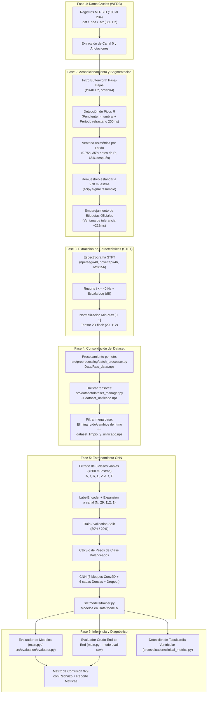

# Clasificador de Arritmias Cardíacas con Redes Neuronales Convolucionales (CNN)

Sistema integral de análisis de señales electrocardiográficas (ECG) para la detección y clasificación automática de arritmias cardíacas utilizando procesamiento digital de señales (Transformada de Fourier de Tiempo Corto - STFT / Espectrogramas) y Deep Learning (CNN 2D en TensorFlow/Keras), validado sobre la base de datos oficial **MIT-BIH Arrhythmia Database**.

---

## Tabla de Contenidos
1. [Descripción General](#-descripción-general)
2. [Diagrama General del Workflow](#-diagrama-general-del-workflow)
3. [Flujo de Trabajo Detallado (Paso a Paso)](#-flujo-de-trabajo-detallado-paso-a-paso)
   - [Fase 1: Adquisición de Datos Crudos](#fase-1-adquisición-de-datos-crudos)
   - [Fase 2: Procesamiento de Señal y Segmentación de Latidos](#fase-2-procesamiento-de-señal-y-segmentación-de-latidos)
   - [Fase 3: Generación de Espectrogramas (Tensores 2D)](#fase-3-generación-de-espectrogramas-tensores-2d)
   - [Fase 4: Consolidación, Limpieza y Mapeo AAMI](#fase-4-consolidación-limpieza-y-mapeo-aami)
   - [Fase 5: Arquitectura y Entrenamiento de la CNN](#fase-5-arquitectura-y-entrenamiento-de-la-cnn)
   - [Fase 6: Inferencia, Evaluación y Diagnóstico Clínico](#fase-6-inferencia-evaluación-y-diagnóstico-clínico)
4. [Estructura del Repositorio y Componentes](#-estructura-del-repositorio-y-componentes)
   - [Archivos en Raíz](#archivos-en-la-raíz)
   - [Evolución Modular: Versión 1.0 y 2.0](#evolución-modular-versiones-10-y-20)
   - [Estructura del Directorio Data/](#estructura-del-directorio-data)
5. [Mapeo de Clases y Estándar Clínico](#-mapeo-de-clases-y-estándar-clínico)
6. [Guía de Ejecución (Cómo usar el proyecto)](#-guía-de-ejecución-cómo-usar-el-proyecto)
7. [Requisitos e Instalación](#-requisitos-e-instalación)

---

## Descripción General

El objetivo del proyecto es transformar registros electrocardiográficos continuos (1D) en representaciones de tiempo-frecuencia (espectrogramas normalizados 2D) que capturen la morfología y componentes espectrales de cada latido cardíaco, para luego clasificarlos mediante una Red Neuronal Convolucional profunda en diferentes tipos de arritmias y condiciones cardíacas.

El proyecto cuenta además con:
- Mecanismo de **balanceo de clases** mediante penalización de pesos (`class_weight='balanced'`).
- Modelo avanzado con **opción a rechazo** (Versión 6.0) mediante una función de pérdida personalizada (`custom_rejection_loss`) que castiga el rechazo injustificado y penaliza severamente los **falsos normales** por su riesgo clínico.
- Evaluadores modulares integrales tanto desde datasets preprocesados (`.npz`) como directo de la señal cruda (`.dat`/`.hea`/`.atr`).

---

## Diagrama General del Workflow



---

## ️ Flujo de Trabajo Detallado (Paso a Paso)

### Fase 1: Adquisición de Datos Crudos
- **Fuente**: Base de datos de arritmias del MIT-BIH (`Data/Database/`), compuesta por 48 registros de 30 minutos grabados a dos canales a **360 Hz**.
- **Archivos por registro**:
  - `.hea`: Encabezado con metadatos del paciente y configuración de canales.
  - `.dat`: Señal binaria digitalizada de voltaje.
  - `.atr`: Anotaciones médicas de cardiólogos con la ubicación exacta (en muestras) y el tipo de cada latido/ritmo.
- **Herramienta**: Biblioteca `wfdb` (`wfdb.rdrecord` y `wfdb.rdann`). Se selecciona el canal principal (Canal 0, derivación modificada MLII).

### Fase 2: Procesamiento de Señal y Segmentación de Latidos
1. **Filtro Digital**: Filtro pasa-bajas Butterworth de orden 4 con frecuencia de corte $f_c = 40\text{ Hz}$ aplicado con `scipy.signal.filtfilt` (fase cero) para remover ruido de alta frecuencia y artefactos musculares (EMG) sin desfasar la señal en el tiempo (`src/preprocessing/preprocessor.py`).
2. **Detección de Picos R**:
   - Algoritmo derivativo basado en pendiente: se evalúa la diferencia entre muestras consecutivas con un umbral de pendiente (`PENDIENTE = 50 * (1 / fs)` o `0.13`).
   - Al encontrar el pico, se avanza un intervalo refractario de seguridad (`salto = 0.2 * fs` = 200 ms) para evitar falsos picos por ondas T prominentes o complejos aberrantes.
3. **Ventana Asimétrica**:
   - Cada latido se recorta con una ventana de **0.75 segundos** (270 muestras a 360 Hz).
   - Distribución asimétrica centrada en el pico R: **35% previo** (complejo QRS inicial y onda P) y **65% posterior** (repolarización y onda T).
4. **Remuestreo**: Mediante `scipy.signal.resample` (basado en FFT), se garantiza que cada ventana tenga exactamente 270 muestras independientemente de pequeñas variaciones de adquisición.
5. **Emparejamiento de Anotaciones**: Se compara cada pico detectado contra las anotaciones oficiales del cardiólogo dentro de una ventana de tolerancia temporal ($\pm 80$ a $90$ muestras, aprox. $222\text{ ms}$). Si no coincide, se clasifica como `"Desconocido"`.

### Fase 3: Generación de Espectrogramas (Tensores 2D)
1. **STFT**: Se calcula la Transformada de Fourier de Tiempo Corto (`scipy.signal.spectrogram`) con:
   - `fs = 360 Hz`
   - `nperseg = 48`
   - `noverlap = 46`
   - `nfft = 256`
2. **Recorte de Banda Espectral**: Se descartan frecuencias superiores a 40 Hz, ya que el contenido relevante del ECG clínico reside en $< 40\text{ Hz}$.
3. **Escala Logarítmica**: Se convierte la potencia a decibeles: $S_{log} = 10 \cdot \log_{10}(S_{xx} + 10^{-10})$.
4. **Normalización Min-Max**: Se escala cada matriz al rango $[0, 1]$.
5. **Dimensiones del Tensor**: El espectrograma resultante tiene dimensiones fijas de **(29, 112)** (29 bins de frecuencia $\times$ 112 pasos de tiempo).

### Fase 4: Consolidación, Limpieza y Mapeo AAMI
1. **Procesamiento Masivo** (`src/preprocessing/batch_processor.py`): Itera sobre todos los registros disponibles y guarda un archivo comprimido individual `Data/Raw_data/<registro>.npz` con arrays `X` (espectrogramas) y `Y` (etiquetas de texto).
2. **Unificación** (`src/dataset/dataset_manager.py`): Concatena los tensores de todos los pacientes en `Data/Raw_data/dataset_unificado.npz` (más de 100,000 latidos).
3. **Filtrado de Calidad** (`src/dataset/dataset_manager.py`):
   - Elimina marcadores de ritmo no latidos (`+`, `~`, `|`, `"`, `!`), latidos descartados (`x`, `[`, `]`) y muestras catalogadas como `"Desconocido"`.
   - Genera `Data/Raw_data/dataset_limpio_y_unificado.npz`.
4. **Selección de Clases Viables**: Para garantizar validez estadística durante el entrenamiento, se seleccionan las clases con soporte mayor a 600 muestras:
   - `N`, `/`, `R`, `L`, `V`, `A`, `f`, `F` (8 clases principales).

### Fase 5: Arquitectura y Entrenamiento de la CNN
- **Módulo de entrenamiento**: `src/models/trainer.py` (y notebook interactivo en `notebooks/Entrenamiento.ipynb`).
- **Preprocesamiento en entrenamiento**:
  - `LabelEncoder`: Convierte etiquetas a enteros $[0 \dots 7]$.
  - `expand_dims`: Adapta dimensiones de `(N, 29, 112)` a `(N, 29, 112, 1)` (formato de imagen monocanal para CNN).
  - Partición Train/Val: 80% entrenamiento, 20% validación estratificada/semilla fija.
- **Balanceo de Clases**: Debido a que la clase normal `N` representa la gran mayoría de muestras respecto a clases críticas como `F` o `A`, se computan pesos inversamente proporcionales con `compute_class_weight(class_weight='balanced')`.
- **Arquitectura de la Red** (`src/models/cnn_model.py`):
  - **Bloque Convolucional 1**: 2 capas `Conv2D(32, 3x3)` + `BatchNormalization` + `MaxPooling2D(2, 2)`.
  - **Bloque Convolucional 2**: 2 capas `Conv2D(64, 3x3)` + `BatchNormalization` + `MaxPooling2D(2, 2)`.
  - **Bloque Convolucional 3**: 2 capas `Conv2D(128, 3x3)` + `BatchNormalization` + `MaxPooling2D(2, 2)`.
  - **Bloque Denso (Clasificador)**: `Flatten` + capas `Dense` progresivas (1024, 512, 256, 128, 64) con `BatchNormalization` y `Dropout` (0.5, 0.4, 0.3).
  - **Capa de Salida**: `Dense(num_clases, activation='softmax')`.
- **Hiperparámetros & Callbacks**:
  - Optimizador: `Adam(learning_rate=1e-3)`.
  - Loss estándar: `sparse_categorical_crossentropy`.
  - `EarlyStopping(patience=8)`, `ReduceLROnPlateau(factor=0.2, patience=3)`.
  - `ModelCheckpoint` guardando `mejor_modelo.keras` o versiones en `Data/Models/`.

#### Mecanismo Avanzado de Rechazo (Modelo 6.0)
Implementado en `src/models/cnn_model.py` y `src/models/classifier.py`:
- Expande el espacio de salida a **9 clases**: las 8 viables + **`No_Clasificable`** (índice 8).
- **Función de Pérdida con Penalización Clínica** (`custom_rejection_loss`):
  $$L_{total} = L_{cross\_entropy} + (1 - y_{reject}) \cdot (\hat{y}_{reject} \cdot P_{rechazo}) + (1 - y_{normal}) \cdot (\hat{y}_{normal} \cdot P_{falso\_normal})$$
  - `PENALIDAD_RECHAZO = 2.0`: Evita que el modelo abuse de la clase de rechazo ante la mínima duda.
  - `PENALIDAD_FALSO_NORMAL = 1.5`: Penaliza con severidad que una arritmia patológica sea clasificada como latido normal `N` (riesgo crítico de falso negativo).

### Fase 6: Inferencia, Evaluación y Diagnóstico Clínico
1. **Evaluación de Rendimiento**:
   - Generación de matrices de confusión normalizadas e integrales de $9 \times 9$.
   - Reporte de clasificación (`precision`, `recall`, `f1-score`, `support`).
2. **Evaluador Crudo End-to-End** (`src/evaluation/evaluator.py` o vía `main.py --mode eval-raw`): Permite tomar cualquier registro no procesado de la base de datos (ej. `Data/Database/100`), aplicarle el pipeline completo en tiempo de ejecución y emitir el diagnóstico.
3. **Módulos de Patologías Específicas** (`src/evaluation/clinical_metrics.py`):
   - Algoritmo para localizar episodios de **Taquicardia Ventricular (VT)** mediante búsqueda de etiquetas explícitas de ritmo (`(VT`) y detección de ráfagas consecutivas de $\ge 3$ latidos ventriculares (`V`), reportando tiempo exacto (MM:SS) y número de muestra.
   - Análisis estadístico de intervalos R-R (media, mediana, desviación estándar, min, max) y cálculo de Frecuencia Cardíaca promedio (BPM).

---

## Estructura del Repositorio y Componentes

```text
Clasificador de arritmias/
│
├── main.py                                      # Lanzador principal: Inicia la App Web local y abre el navegador
├── maestro.py                                   # Orquestador Maestro CLI / Consola interactiva (Opciones 0-7)
├── README.md                                    # Documentación completa del proyecto
├── mejor_modelo.keras                           # Checkpoint del mejor modelo entrenado
│
├──  src/                                      # Código fuente modular organizado por fases
│   ├── __init__.py
│   │
│   ├──  preprocessing/                        # Fase 1 y 2: Acondicionamiento de señal y extracción STFT
│   │   ├── __init__.py
│   │   ├── preprocessor.py                      # Clase PreprocesadorECG (filtros, picos R, ventanas, espectrograma)
│   │   ├── batch_processor.py                   # Procesamiento masivo de registros (.dat/.hea -> .npz)
│   │   └── csv_analyzer.py                      # Workflow Principal: Procesamiento de archivos CSV externos (Voltaje vs Tiempo) y predicción pulso por pulso
│   │
│   ├──  dataset/                              # Fase 3 y 4: Gestión, unificación e inspección de datos
│   │   ├── __init__.py
│   │   ├── dataset_manager.py                   # Unificación, filtrado AAMI y carga de datos limpios
│   │   └── inspector.py                         # Inspección de tensores .npz y comparación vs .atr
│   │
│   ├──  models/                               # Fase 5: Modelado, entrenamiento e inferencia
│   │   ├── __init__.py
│   │   ├── cnn_model.py                         # Arquitectura CNN y custom_rejection_loss
│   │   ├── classifier.py                        # ClasificadorArritmiasCNN (motor de inferencia)
│   │   └── trainer.py                           # Pipeline de entrenamiento reproducible
│   │
│   ├──  evaluation/                           # Fase 6: Evaluación y diagnóstico clínico
│   │   ├── __init__.py
│   │   ├── evaluator.py                         # Evaluadores paciente crudo y archivos .npz
│   │   └── clinical_metrics.py                  # Detección de Taquicardia Ventricular (VT) y análisis R-R / BPM
│   │
│   └──  web/                                  # CardioLab: Estación Experimental Médica (Flask + HTML5 Canvas Reciclables)
│       ├── __init__.py
│       ├── server.py                            # Servidor API Flask con endpoints REST para CSV y registros
│       ├──  templates/
│       │   └── index.html                       # Dashboard de telemetría médica y visor reciclable de pulsos
│       └──  static/
│           ├──  css/
│           │   └── style.css                    # Estilos CSS clínicos modernos con glassmorphism
│           └──  js/
│               └── app.js                       # Renderizador de Canvas reciclable (0 MB disco) y controlador UI
│
├──  notebooks/                                # Cuadernos Jupyter para experimentación y análisis
│   ├── Entrenamiento.ipynb                      # Pipeline interactivo de entrenamiento
│   ├── Entrenamiento_Modificado_EfficientNetB0.ipynb # Experimento con Transfer Learning
│   ├── Rendimiento_modelos.ipynb                # Evaluación del modelo v6.0 con función de rechazo
│   ├── Rendimiento_modelos_pre_5.0.ipynb        # Evaluación de modelos v1.0 a v4.0
│   ├── Separador_de_pulsos.ipynb                # Exploración interactiva de segmentación R
│   └── Transformada_rapida.ipynb                # Exploración interactiva de parámetros STFT
│
└──  Data/                                     # Repositorio de datos
    ├──  Database/                             # Base de datos MIT-BIH (48 registros: .dat, .hea, .atr)
    ├──  Raw_data/                             # Registros procesados individuales .npz y datasets unificados
    │   ├── <100..234>.npz                       # Tensores por paciente
    │   ├── dataset_unificado.npz                # Todos los latidos concatenados
    │   └── dataset_limpio_y_unificado.npz       # Dataset final filtrado sin ruido
    ├──  Models/                               # Modelos serializados .keras (1.0 a 6.0)
    └──  Estadisticas/                         # Gráficas de rendimiento, ROC, matrices y Grad-CAM
```

---

## ️ Mapeo de Clases y Estándar Clínico

Las arritmias se catalogan según los estándares de la **AAMI (Association for the Advancement of Medical Instrumentation)** y las anotaciones de MIT-BIH:

| Símbolo | Nombre Clínico | Categoría AAMI | Estado en Modelo |
| :---: | :--- | :---: | :---: |
| **`N`** | Latido normal (*Normal beat*) | **N** | Activo (Clase 0) |
| **`/`** | Latido de marcapasos (*Paced beat*) | **Q** | Activo (Clase 1) |
| **`R`** | Bloqueo de rama derecha (*Right bundle branch block*) | **N** | Activo (Clase 2) |
| **`L`** | Bloqueo de rama izquierda (*Left bundle branch block*) | **N** | Activo (Clase 3) |
| **`V`** | Contracción ventricular prematura (*Premature ventricular contraction*) | **V** | Activo (Clase 4) |
| **`A`** | Contracción auricular prematura (*Atrial premature beat*) | **S** | Activo (Clase 5) |
| **`f`** | Fusión de latido con marcapasos (*Fusion of paced and normal beat*) | **Q** | Activo (Clase 6) |
| **`F`** | Fusión de latido ventricular y normal (*Fusion of ventricular and normal*) | **F** | Activo (Clase 7) |
| **`No_Clasificable`** | Ruido, latidos atípicos, artefactos o latidos con alta incertidumbre | **Rechazo** | Activo (Clase 8 en v6.0) |

---

## Guía de Ejecución (Cómo usar el proyecto)

El proyecto ofrece dos vías de ejecución: la **Aplicación Web Local (Recomendada)** y el **Orquestador Maestro en Terminal**.

### Modo 1: Aplicación Web Local en Navegador (Automático al ejecutar `main.py`)
Para iniciar la estación de trabajo experimental médica, simplemente ejecuta:
```bash
python main.py
```
**¿Qué sucede automáticamente?**
1. Se levanta el servidor backend local Flask en `http://127.0.0.1:5000`.
2. Se abre automáticamente tu navegador web predeterminado en la aplicación **CardioLab**.
3. **Workflow Principal (Análisis de CSV)**:
   - Permite arrastrar o cargar cualquier archivo CSV externo de **Voltaje vs Tiempo** (o pulsar *Cargar Señal de Prueba* para un ECG clínico de 20s).
   - Filtra la señal con un filtro pasa-bajas Butterworth a 40 Hz.
   - Detecta y segmenta cada pico R en una ventana asimétrica estándar de 270 puntos.
   - Computa la STFT (espectrograma 2D de 29x112) de cada pulso individual.
   - Evalúa cada latido en la CNN v6.0 y retorna la predicción y nivel de confianza.
   - **Visualización Reciclable (0 MB en disco)**: Muestra la señal completa y un visor dinámico de pulso individual con el corte 1D (con papel milimétrico e isoelectro), el espectrograma STFT en mapa de calor y la distribución de probabilidades, redibujados al vuelo en HTML5 Canvas sin generar archivos de imagen temporales que saturen el almacenamiento.
   - Permite filtrar la tabla ("Todos", "Solo Arritmias", "Solo Normales") y exportar el reporte completo a CSV.
4. Incluye además las pestañas para registros MIT-BIH, evaluación con matriz 9x9, escaneo de Taquicardia Ventricular e inspector de tensores `.npz`.

*(Opciones adicionales: `python main.py --port 8080` para cambiar el puerto, o `python main.py --no-browser` si no deseas que abra el navegador automáticamente).*

---

### Modo 2: Orquestador Maestro en Terminal (`maestro.py`)
Si prefieres trabajar en consola o scripts automatizados, utiliza el archivo maestro:

#### Menú Interactivo en Consola:
```bash
python maestro.py
# O equivalentemente:
python main.py --cli
```
Presenta un menú interactivo con opciones numeradas (0 al 8) para guiarte paso a paso por cada etapa.

#### Comandos Directos por CLI:
```bash
# 1. Workflow Principal: Analizar archivo CSV (Voltaje vs Tiempo) pulso por pulso:
python maestro.py --mode predict-csv --file Data/ejemplo_ecg_voltaje_tiempo.csv
# Con exportación opcional a reporte CSV:
python maestro.py --mode predict-csv --file Data/ejemplo_ecg_voltaje_tiempo.csv --output reporte_pulsos.csv

# 2. Extraer segmento puro de paciente MIT-BIH a CSV (Cero Fuga de Datos):
python maestro.py --mode extract-csv --record 200 --duration 30 --start 0
# Y luego clasificarlo ciegamente pulso por pulso:
python maestro.py --mode predict-csv --file Data/Extraidos/ecg_registro_200_30s.csv

# 3. Evaluar paciente crudo (.dat/.hea/.atr) con reporte y matriz:
python maestro.py --mode eval-raw --record 100 --model 6.0

# 4. Evaluar archivo .npz preprocesado:
python maestro.py --mode eval-npz --file Data/Raw_data/100.npz --model 6.0

# 5. Buscar episodios de Taquicardia Ventricular (VT):
python maestro.py --mode vt-search

# 6. Preprocesar registros (.dat -> .npz):
python maestro.py --mode preprocess --record 100
python maestro.py --mode preprocess --record all

# 7. Unificar y filtrar datasets para entrenamiento:
python maestro.py --mode unify
python maestro.py --mode filter

# 8. Entrenar el modelo CNN:
python maestro.py --mode train --epochs 50 --batch-size 256

# 9. Inspeccionar tensores .npz o comparar con anotaciones oficiales:
python maestro.py --mode inspect --file Data/Raw_data/100.npz
python maestro.py --mode inspect --record 103
```

---

## Requisitos e Instalación

### Entorno recomendado
- Python 3.10 o superior (compatible con Python 3.11 / 3.12 / 3.13 en Windows con soporte CPU/WSL2).
- Entorno virtual activado (`.venv`).

### Dependencias requeridas
```bash
pip install numpy scipy matplotlib seaborn scikit-learn pandas wfdb tensorflow keras flask
```
*(Opcional: Si se desea aceleración por GPU en Windows nativo para TensorFlow $\ge 2.11$, se recomienda utilizar **WSL2**).*

---

### Notas y Mejores Prácticas
1. **Arquitectura modular (`src/`)**: Cada paquete (`preprocessing`, `dataset`, `models`, `evaluation`) es autónomo y reutilizable tanto desde scripts como desde notebooks o aplicaciones web/APIs.
2. **Normalización consistente**: Toda señal analizada debe muestrearse a 360 Hz (o remuestrearse a dicha frecuencia) para que los bins de Fourier generen exactamente la matriz esperada de **(29, 112)**.
3. **Pérdida personalizada**: Al cargar modelos que contengan `custom_rejection_loss` (como `modelo_arritmias_cnn_6.0.keras`), el motor `ClasificadorArritmiasCNN` registra y resuelve automáticamente la función sin requerir configuración manual.
